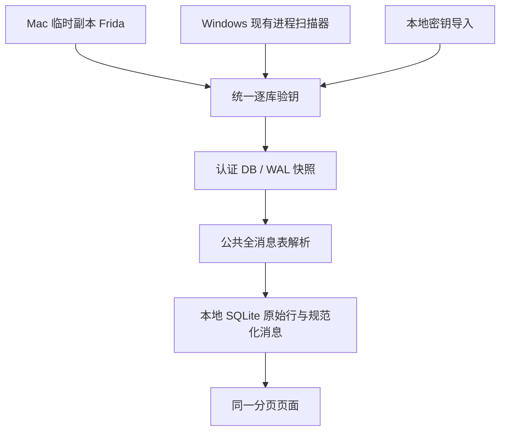

# 统一架构

内部与实施说明，中文优先。

模块分别为 `bootstrap`、`pipeline`、`snapshot`、`parser`、`storage`、`security`、`server` 和 `web`。每个账号输出单独保存，来源绑定后才可重建；不自动跨设备合并。快照是新的私有 generation，认证失败不发布新的聊天归档。

密钥通过页 HMAC 认证；逐页认证和 SQLite 完整性分别记录。专用 FTS 索引可使用严格检查的扩展缺失例外，但不会标成完整性通过。解析保留每条原始消息来源，正数服务器 ID 在同会话内识别重复，非正数 ID 采用库/表/本地 ID；当前整库重建不承诺持续更新版本保留。

页面服务只绑定本机回环，检查 Host / Origin，API 要求本次 Bearer 令牌。静态文件只有三个固定路由；不提供路径参数下载。SQLite 使用只读不可变连接、参数化查询、100 条分页。状态报错不携带原始 SQL、正文、密钥或源路径。

Fomomo、Gist 不参与默认运行链路。Mac 与 Windows 的区别集中在初始化与原生 AES / 凭据存储；公共解析与页面相同。
