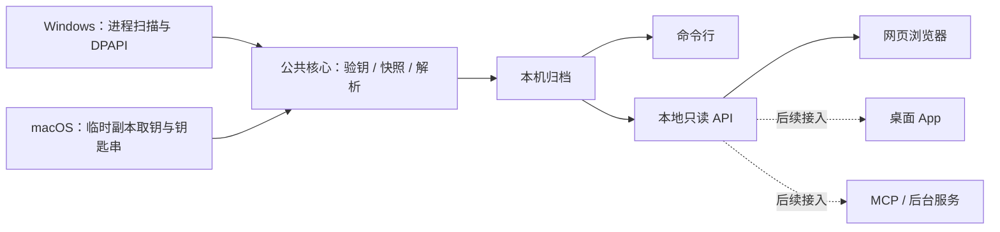

# 本地服务与其他封装

同一核心支持三个现有入口：Python 模块/命令行、本地网页、只读 HTTP API。桌面 App、MCP 或系统后台服务可作为后续外壳接入；v0.1.0 未交付这些外壳。

## 启动服务

```sh
python -m wechat_archive serve --archive "/private/archive/archive.sqlite" --port 8765
```

只绑定 `127.0.0.1`。输出页面地址的 `#` 后是当前启动会话令牌；请求 API 时通过 `Authorization: Bearer <session-token>` 发送。令牌每次启动更换，请勿写入公共配置、日志或 issue。服务只读已有归档，停止后端口与令牌失效。

## HTTP 合同

所有列表响应都有 `total`、`page`、`page_size`、`rows`。`page` 从 0 开始，每页 100 条，超过末页会返回实际末页编号。时间单位为 Unix 秒。

| 接口 | 参数 | 返回 |
| --- | --- | --- |
| `GET /api/status` | 无 | 来源与解析统计、范围与限制 |
| `GET /api/rooms` | `page`、`q`、`kind` | 会话分页；`kind` 为 `group/private/service/system/unmapped` |
| `GET /api/messages` | `room` 必需；`page`、`q`、`type`、`from`、`before` | 消息分页；`from` 含边界、`before` 不含边界 |

搜索词按字面匹配，`%` 和 `_` 不代表通配符。只允许当前服务的 Host 与同源浏览器请求；没有任意文件访问路由、写入接口或远程监听选项。API 的消息字段含 `message_key`、`sender_name`、`create_time`、`local_type`、`content`、`parse_state`。

Python 调用者也可实例化 `wechat_archive.server.ArchiveServer`，读取其 `origin` 与 `token`；不要把 `server.url` 记录到共享日志。

## 后续外壳



后台自动导入、增量与跨设备去重需要额外的锁、调度和来源合同，不能简单把当前批量命令无限循环。本预览版通过调用者持有的锁串行写入，文件发布失败会回滚旧数据库与元数据；不承诺断电或整个进程被强杀时的整套事务原子性。浏览时避免同时重建同一归档，重建完成后刷新查看。

若报告 `archive_recovery_required`，停止读取/重建该归档，保留输出目录下 `.publish-*/previous/` 的旧文件备份并进行人工恢复。程序不会删除恢复失败时的备份。
