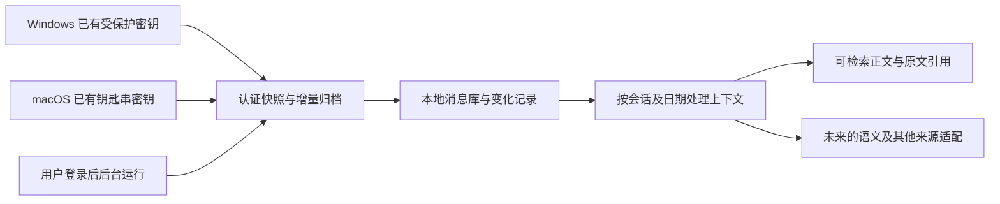

# v0.2.0 持续归档预览范围

交付 MIT 开源源码、公共 Python wheel、Windows/macOS Python 便携启动包。需要 Python 3.11+ 和首次依赖安装；原生签名 App/EXE 安装包仍另行交付。

在此前的显式验钥、原生凭据保护、认证 DB/WAL 快照、全消息表解析与本地分页浏览之上，本版增加两条相接的处理链：

- 同一核心按变化的数据库重新认证快照，保留已观察历史，记录更正和消息标识迁移。首次全量归档，随后增量更新；每小时复核源库。
- 上下文按有限批次推进，数据与进度同事务提交，中断后继续。支持 FTS5，索引不可用或恢复中明确返回降级状态。
- `service-install` 在 macOS 创建用户 LaunchAgent，在 Windows 创建当前用户登录触发的计划任务。电脑需要处于开机、登录、唤醒状态；微信及源数据库可用才会持续更新。睡眠或关机期间不处理。
- 失败重试和状态文件只记录固定状态与计数；服务不重新取钥、重启微信、上传正文或发布知识。

验证分层：合成测试覆盖历史回填、晚到消息、旧消息更正、来源隔离、事务回滚、重复执行、中断恢复、FTS恢复、WAL冲突与文件链接保护；服务配置生成使用纯 mock 测试，Windows/Linux/macOS CI分别验证。具体版本的CI状态以仓库 Actions 为准，构建成功不代替设备验收。

Mac 本机连续链路的运行结果另记在私有交付报告，公共仓库不含真实账号路径、密钥或聊天。Windows 新后台服务仍需要用户设备上的运行验收，不能把 CI 写成所有微信版本真机成功。

当前未完成：语义摘要、项目/事件分类、待办生成、其他上下文来源接入、跨设备合并、媒体本体、真实浏览器界面验收及原生安装包。当前输出是可追溯的本地数据底座，不代表所有上下文已进行智能加工。
